&nbsp;&nbsp;

## 🦆 My debugging partner

  
   
  <i>Rubber duck debugging: explain your code to the duck, line by line, until the bug confesses.</i>

## 💼 Experience

🤖 &nbsp;**AI Engineer Intern** &nbsp;

📱 &nbsp;**App Developer Intern** &nbsp;

🔬 &nbsp;**Computer Vision Researcher** &nbsp; 

🧑‍🏫 &nbsp;**Grader, ICS 343 Computer Networks** &nbsp; 

## 🚀 Featured projects

> ### 🔥 AI Melt Pool Segmentation
> Hybrid **SAM + U-Net** model that finds the melt pool in industrial welding video, even under blinding arc light.
>
>    

> ### ⚙️ CoreSched
> Multi-core **CPU scheduling simulator** with load balancing, CPU affinity and a live dashboard.
>
>   

> ### 🎉 University Clubs Hub
> Full-stack platform that brings all university **clubs and events** into one place.
>
>   

## 🎓 Education

**B.Sc. Software Engineering · KFUPM** &nbsp;  

**KAUST AI Program** &nbsp;

## 🧰 Tech stack

## 🌟 Leadership

    

